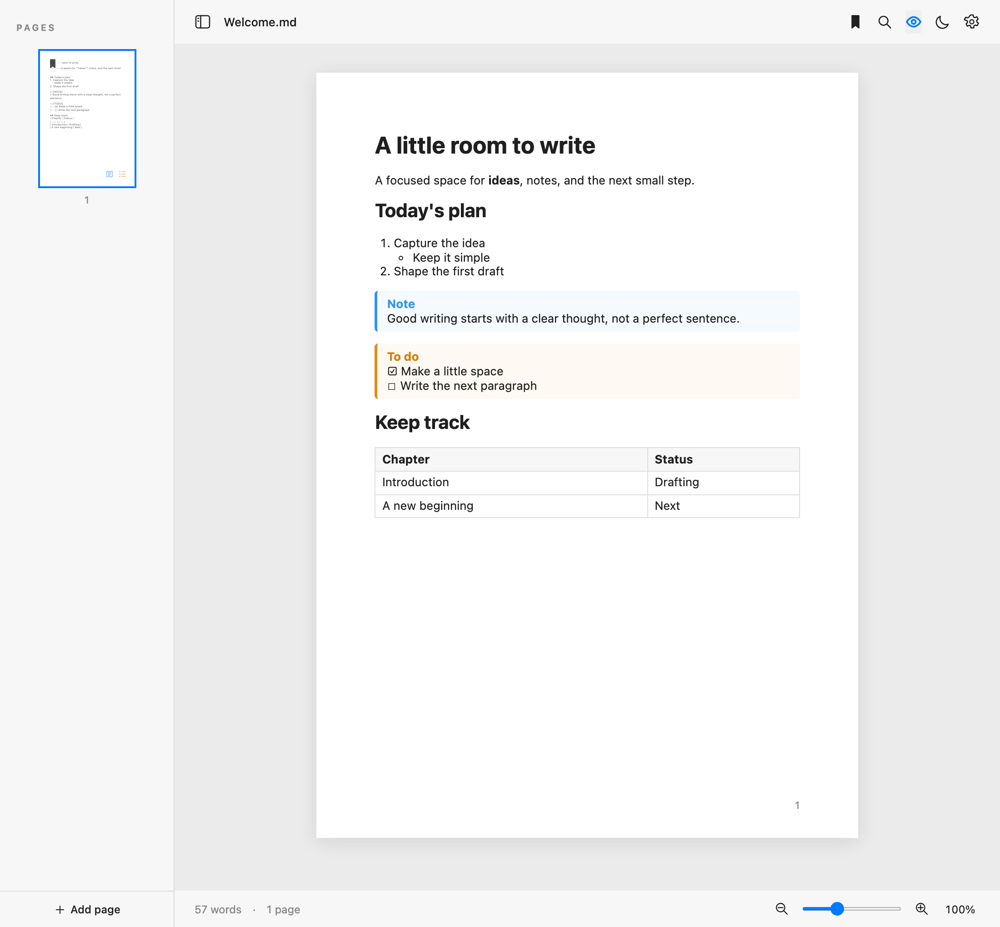

<p align="center"></p>

# Clean Writer

A focused Markdown editor for **Linux, Windows, and macOS**, rebuilt with **Rust + Tauri 2** on the `rust` branch. The interface uses TypeScript, CSS, and CodeMirror; Rust handles Markdown parsing, native file dialogs, document storage, and recovery. No Swift or Xcode application code is required.

This branch is the cross-platform 2.0 development version. The existing 1.x GitHub releases are the previous macOS application, not builds of this branch.



## Features

- A4 source pages with the Swift app’s 595.28 × 841.89-point canvas, neutral light/dark appearance, 192-point sidebar, icon toolbar, and footer. One CodeMirror document keeps undo/redo, selection across pages, search, and line wrapping.
- Local and web images in preview, thumbnails, and PDF export, with an Insert image file picker.
- Formatted A4 preview with automatic pagination, page numbers, thumbnails, and manual page breaks.
- Headings, emphasis, strikethrough, code, links, tables, nested lists, quotes, and task lists.
- Blue `[!NOTE]` and amber `[!TODO]` callouts. Quoted and bare markers are supported; markers inside code stay literal.
- New, Open, Open Recent, Save, Save As, and Export PDF through native File menus.
- One-second autosave, draft recovery, per-file cursor positions, and bookmarks that follow edits. A small bookmark symbol appears at the top-left of page thumbnails; note/todo symbols stay bottom-right. Toggle a bookmark from any row on its page.
- Safe file replacement and external-change detection. A failed save retains your recovery copy; use Save As if another editor changed the file.
- Light/dark appearance, serif/sans/monospaced fonts, font size, margins, sidebar visibility, and 50–200% zoom.
- Markdown file associations in installers, command-line file opening, and a single desktop instance.
- Local-only storage: no account, analytics, cloud backend, or automatic updater.

## Run from source

Install **Node.js 22 LTS**, **Rust stable**, and the [Tauri system prerequisites](https://v2.tauri.app/start/prerequisites/) for your operating system.

Rust and Node.js are required to build/run from source. They are not required to use a packaged installer.

On Linux/macOS, install Rust using the [official rustup installer](https://rust-lang.org/tools/install/):

```sh
curl --proto '=https' --tlsv1.2 -sSf https://sh.rustup.rs | sh
. "$HOME/.cargo/env"
cargo --version
rustc --version
```

Choose the default installation when prompted. On Windows, download and run `rustup-init.exe` from the official installation page, then open a new terminal and verify `cargo --version` and `rustc --version`.

On Debian/Ubuntu:

```sh
sudo apt-get update
sudo apt-get install -y libwebkit2gtk-4.1-dev build-essential curl wget file libxdo-dev libssl-dev libayatana-appindicator3-dev librsvg2-dev
```

Windows requires Microsoft C++ Build Tools with the desktop C++ workload and WebView2. macOS requires Xcode Command Line Tools. Linux file dialogs use the desktop's XDG portal; a working `xdg-desktop-portal` and an appropriate desktop backend are needed.

From the repository root:

```sh
npm ci
npm run desktop
```

### Troubleshooting: Cargo not found

If `npm run desktop` reports `failed to run 'cargo metadata'` with `No such file or directory (os error 2)`, Tauri cannot find Cargo. Install Rust using the instructions above, or open a new terminal after an existing installation.

On Linux/macOS, activate the default installation in your current shell:

```sh
. "$HOME/.cargo/env"
cargo --version
npm run desktop
```

On Windows, ensure `%USERPROFILE%\.cargo\bin` is on `PATH` and restart your terminal. Temporary tools under `.local-tools/` are not included in Git; a fresh checkout needs its own Rust installation.

`npm run dev` opens only the browser interface for layout work. Native files, Rust Markdown rendering, and PDF export require `npm run desktop`.

## Build installers

```sh
npm run desktop:build
```

Output is under `src-tauri/target/release/bundle/`. Build on the target operating system: Windows installers on Windows, macOS bundles/DMGs on macOS, and Linux packages on Linux. The GitHub Actions workflow builds all three and uploads artifacts; it does not publish releases. Builds are unsigned unless signing is configured separately. The macOS CI job builds the runner's architecture, not a universal Intel/Apple Silicon binary.

## Keyboard shortcuts

Use **Ctrl** on Windows/Linux and **⌘** on macOS.

| Action                       | Shortcut                |
| ---------------------------- | ----------------------- |
| New                          | Ctrl/⌘N                 |
| Open                         | Ctrl/⌘O                 |
| Save                         | Ctrl/⌘S                 |
| Save As                      | Ctrl/⌘Shift+S           |
| Export PDF                   | Ctrl/⌘Shift+E           |
| Find                         | Ctrl/⌘F                 |
| Next / previous match        | Ctrl/⌘G / Ctrl/⌘Shift+G |
| Toggle current page bookmark | Ctrl/⌘D                 |
| Toggle sidebar               | Ctrl/⌘Alt+S             |
| Undo / redo                  | Ctrl/⌘Z / Ctrl/⌘Shift+Z |
| Quit                         | Ctrl/⌘Q                 |

Use the zoom slider, Ctrl+wheel/trackpad pinch, or click the zoom percentage to reset to 100%. Preview is read-only; edit task-list markers in source to complete tasks.

## Documents and recovery

Documents remain UTF-8 `.md` files. Manual page breaks retain the original form-feed character (`U+000C`) and create a new A4 source page. Automatic A4 page spaces in source, preview, and PDF do not change the saved Markdown.

Settings, recent paths, navigation, the active document, and its saved baseline are stored in `session-v2.json` in Tauri's OS-specific application data directory. A recovery checkpoint is scheduled 200 ms after edits or cursor changes. Close/quit flushes recovery; named documents also save when possible. Abrupt process termination can lose edits made since the last completed checkpoint.

The Swift application's macOS preferences are not imported. Your existing Markdown documents can be opened directly; previously stored settings, recent files, bookmarks, and unsaved Swift drafts remain in the old application's preferences.

## Images

Use **··· → Insert image…**, or ordinary Markdown:

```markdown


```

Local paths resolve relative to the saved Markdown file. Keep an `images/` folder beside your document for portability. The picker inserts a relative link for files within the document's folder, and an absolute `file://` link otherwise. Save an untitled document before using relative paths; absolute links work in untitled drafts.

PNG, JPEG, GIF, WebP, and BMP are supported. GIFs render their first frame. JPEG camera orientation is applied. SVG is not supported. Images fit within A4 content margins, move intact between pages, and are embedded into exported PDFs. Missing or unsupported images show an inline placeholder; hover over it for the error.

Web image URLs are downloaded when rendering preview or generating page thumbnails, including while editing source. PDF export fetches them again. Requests do not use browser login cookies. Local-only documents remain offline; linking a web image contacts its host. Embedded base64 raster images are also supported.

Images are limited to 16 MB per file/download and 8192 pixels per dimension; large images are resized to at most 2400 pixels per dimension for display/export. Preview caches up to 16 images for 30 seconds; reopening preview refreshes them.

## Current differences and limits

- Source pagination measures Markdown source rows; formatted preview/PDF can have a different page count. Page thumbnails represent source pages and jump to their source position or bookmark.
- PDF pages are high-resolution images of the formatted layout, including Unicode and page numbers. Exported text is **not selectable/searchable**, and long PDFs can be large. This differs from the previous native text PDF exporter.
- Fonts and webview text metrics can differ between operating systems. Long blocks flow across pages; unusual oversized non-text content may require smaller fonts or margins.
- HTML is displayed as literal text. No mathematical formulas, syntax colouring, or footnotes are provided.
- Webview spelling assistance depends on the operating system; native macOS automatic correction parity is not guaranteed.
- Files must be UTF-8 and at most 20 MB when opened. Very long documents may take time to paginate or export.
- Installers require their respective build/test environments. UI and backend checks on one platform do not prove installer behavior on other operating systems.

## Checks

```sh
npm test
npm run format:check
npm run build
cargo test --manifest-path src-tauri/Cargo.toml --locked
cargo test --manifest-path src-tauri/Cargo.toml --locked -- --ignored
cargo fmt --manifest-path src-tauri/Cargo.toml --check
cargo clippy --manifest-path src-tauri/Cargo.toml --locked -- -D warnings
npx playwright install chromium
npm run test:ui
```

Rust tests cover Markdown rendering, image decoding and path resolution, JPEG orientation, Unicode saves, recovery, navigation, external-change protection, and failed-open rollback. TypeScript tests cover document anchors and preferences. UI tests exercise editing, save failures, document replacement, search, pagination, appearance, and PDF generation using a mocked desktop bridge; they do not replace native OS testing.

## Project structure

```text
src/                 TypeScript editor, interface, and page layout
src-tauri/src/       Rust desktop commands, Markdown parser, storage
src-tauri/icons/     Desktop icons
src-tauri/           Tauri configuration and Rust dependencies
tests/               Unit tests and browser interface tests
.github/workflows/   Windows, Linux, and macOS build pipeline
```

## License

[MIT](LICENSE). Copyright © 2026 chronis10.
