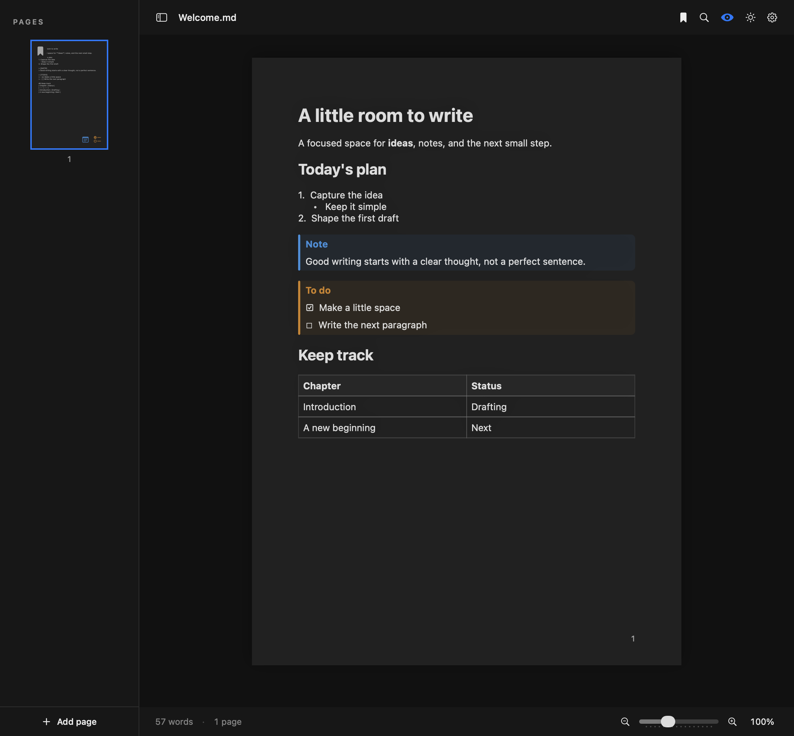
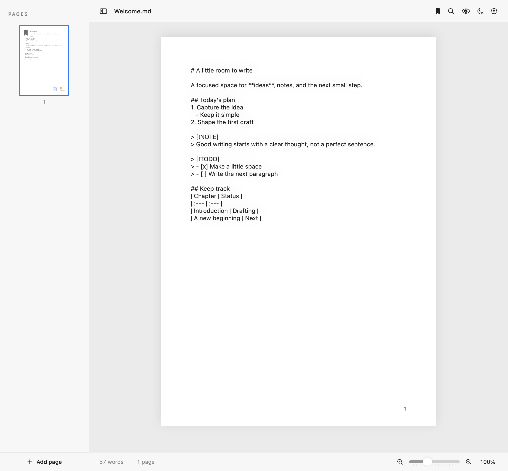

<p align="center">
  
</p>

# Clean Writer

A focused, native macOS Markdown editor with A4 pages, live preview, notes, and to-do lists.

**[Download from GitHub Releases](https://github.com/chronis10/clean_writer/releases)** · **macOS 14 Sonoma or later** · **Apple Silicon and Intel** · **MIT licensed**


## Download and install

1. Open the [Releases page](https://github.com/chronis10/clean_writer/releases).
2. Download `Clean-Writer-1.1.0-macOS-universal.dmg` or the equivalent ZIP from **Assets**. GitHub's “Source code” archives are the project source, not the ready-to-run app.
3. Open the DMG and drag **Clean Writer.app** into **Applications**, or extract the ZIP and move the app there.
4. Open Clean Writer from Applications.

### Opening the unsigned app

**You can use this release without Xcode, an Apple Developer account, or the App Store.** The app is unsigned and is not notarized by Apple, so macOS may block its first launch.

If you trust this release:

1. Move **Clean Writer.app** into **Applications** and try opening it.
2. Open **System Settings → Privacy & Security**.
3. Scroll down and click **Open Anyway** for Clean Writer.
4. Confirm **Open** when macOS asks.

macOS normally remembers this exception, so future launches work by double-clicking the app. Company- or school-managed Macs may restrict this option. You should not disable Gatekeeper globally. See [Apple's instructions for opening unsigned apps](https://support.apple.com/en-us/102445).

The universal app contains `arm64` and `x86_64` binaries. Apple Silicon has been tested locally; an Intel Mac and older macOS versions have not been tested on physical hardware. SHA-256 checksums are attached to each release as `SHA256SUMS.txt`.

## Features

- **A4 writing canvas:** document fonts and margins use print points, with automatic pagination and manual “Add page” breaks. Arrow keys move the cursor between pages.
- **Markdown source and preview:** switch with the eye button; preview keeps headings, line breaks, lists, tables, and inline formatting readable.
- **Notes and todos:** blue note callouts, amber todo callouts, and small reminders in the page thumbnails.
- **Resume and bookmarks:** reopen each file at its last cursor position. Use ⌘D to bookmark the current page at the cursor, or remove its bookmark from any row on that page; bookmarked page previews show a small symbol at the top-left. Click the preview to jump there, or right-click its bookmark symbol for individual jump/remove options. Bookmarks follow edits. The saved cursor and bookmarks are stored locally per file; they are not added to the Markdown text. Renaming/moving a file or editing it externally may affect restoration.
- **Find:** search the complete Markdown source with ⌘F, highlighted matches, a match count, next/previous navigation with wraparound, and optional case matching. Find switches to source mode; Escape closes the search field and returns to the match.
- **File handling:** New, Open, Open Recent (10 files), Save, Save As, and Export PDF in the File menu.
- **Auto-save:** named Markdown files save after a one-second typing pause, and pending changes save when you switch away, close, or quit. Untitled drafts are recovered locally until you choose a file location.
- **Native spelling assistance:** macOS spell checking, suggestions, and automatic spelling correction in source mode.
- **Focus controls:** hide the page sidebar, switch light/dark appearance, and zoom from 50% to 200% with the slider or trackpad pinch.
- **Typography:** serif, sans-serif, and monospaced fonts; adjustable point size and margins.
- **Document status:** live word and page counts, filename, and an unsaved-change indicator. Failed auto-saves retain the recovered draft and show a retry action.
- **PDF export:** formatted Markdown on A4 pages, page numbers, Unicode text, callouts, tables, and long content flowing onto additional pages. Export is independent of screen zoom.



## Keyboard shortcuts

| Action | Shortcut |
| --- | --- |
| Add / remove bookmark | ⌘D |
| Find | ⌘F |
| Next / previous match | ⌘G / ⇧⌘G |
| Close Find (in its search field) | Escape |
| New document | ⌘N |
| Open | ⌘O |
| Save | ⌘S |
| Save As | ⇧⌘S |
| Export PDF | ⇧⌘E |
| Show/hide page sidebar | ⌃⌘S |

The eye, sun/moon, and cog buttons control preview, appearance, and typography. Click the zoom percentage to return to 100%.

## Supported Markdown

| Element | Syntax |
| --- | --- |
| Headings | `# Heading` through `###### Heading`; underline-style headings also parse |
| Bold / italic | `**bold**`, `*italic*`, `***bold italic***` |
| Strikethrough | `~~removed text~~` |
| Inline code | Backticks around code |
| Bullet lists | `- item`, `* item`, or `+ item` |
| Numbered lists | `1. item`; starting numbers are preserved |
| Nested lists | Indent child items beneath their parent; mixed bullets and numbering work |
| Task lists | `- [ ] Pending` and `- [x] Done` |
| Quotes / nested quotes | `> Quote` and `> > Nested quote` |
| Fenced / indented code | Triple backticks, triple tildes, or an indented code block |
| Links | `[label](https://example.com)`; reference links and Markdown autolinks also parse |
| Horizontal rule | `---`, `***`, or `___` on a separate line |
| Tables | Pipe-separated cells and a header separator; left, center, and right column alignment |
| Notes / todos | `> [!NOTE]` and `> [!TODO]`; bare markers at the start of a paragraph are also accepted |
| Escaped punctuation | `\*literal asterisks\*` |

### Lists and nested numbering

```markdown
- A main item
  - A nested bullet
    - A deeper bullet

3. Start at three
   1. First subitem
   2. Second subitem
4. Continue at four
```

Wrapped list text aligns with the item body, and continuation paragraphs do not repeat the marker.

### Notes and tasks

```markdown
> [!NOTE]
> Remember **this detail**.

> [!TODO]
> - [ ] Finish the introduction
>   - [ ] Check the references
> - [x] Review the draft
```

Preview is read-only: edit `[ ]` to `[x]` in source to complete a task. Notes that span pages keep their thumbnail reminder on each relevant page. Literal examples inside code blocks do not trigger reminders.

### Tables

```markdown
| Feature | Status | Count |
| :--- | :---: | ---: |
| Nested lists | Ready | 3 |
| Notes | Ready | 2 |
```

### Code

````markdown
```swift
let title = "Clean Writer"
print(title)
```
````



## Files, privacy, and current limits

Clean Writer writes UTF-8 `.md` files. Draft recovery, cursor positions, document bookmarks, saved-file access permissions, and recent-file history are stored locally in macOS preferences. There is no account, analytics service, or cloud backend in the app. Clicking a Markdown link opens that destination in your browser.

Manual page breaks use the form-feed character (`U+000C`) in the saved Markdown source. Other editors may display or ignore it. Automatic page boundaries in source mode measure source text; formatted preview and PDF can wrap differently, so the exported PDF page count may differ from the editor's count.

The editor uses separate text views for each source page. Typing overflow and arrow-key movement transfer the caret between pages automatically, but selecting or editing text across multiple pages is not a continuous single-text-view selection. Markdown is parsed per visible source page in preview, so a Markdown block split by a source page boundary can lose context there; PDF export renders each manually separated document section before pagination.

Images currently display their alt text rather than embedding the image. HTML rendering, syntax highlighting, mathematical formulas, footnotes, and automatic application updates are not provided. Updates can be downloaded from GitHub Releases.

## Build from source

Use Xcode 26 or later on macOS. The deployment target is macOS 14. There are no third-party package dependencies.

```sh
git clone https://github.com/chronis10/clean_writer.git
cd clean_writer
open clean_writer.xcodeproj
```

Choose the `clean_writer` scheme and run. Code signing is disabled in the project; an Apple Developer account is not required to build it.

For an unsigned universal release build:

```sh
xcodebuild -project clean_writer.xcodeproj -scheme clean_writer \
  -configuration Release -destination 'generic/platform=macOS' \
  -derivedDataPath build ARCHS='arm64 x86_64' ONLY_ACTIVE_ARCH=NO \
  CODE_SIGNING_ALLOWED=NO build
```

The app is produced at `build/Build/Products/Release/Clean Writer.app`. Build products, personal Xcode settings, signing material, and local development helpers are excluded from the repository.

## Contributing

Report bugs or suggest improvements through [GitHub Issues](https://github.com/chronis10/clean_writer/issues). Include the macOS version, app version, steps to reproduce, and a minimal Markdown example. Remove private content from screenshots and sample documents.

Small, focused pull requests are welcome. Please describe the change and how you checked it, including preview and PDF output when changing Markdown rendering.

## License

[MIT](LICENSE). Copyright © 2026 chronis10.
